  
# 👋 ¡Hola Mundo! Soy Rodrigo Angeloni

### 🇵🇾 Estudiante universitario | UAA - Paraguay
### 🚀 DevOps Enthusiast | Game Server Admin | Linux Power User

---

## 👨‍💻 Sobre Mí

- 💼 Estudiante universitario en **UAA - Paraguay**
- 🎓 Aprendiz apasionado de **programación** y **administración de sistemas**
- 🖥️ Administrador de servidores multijugador (**Assetto Corsa** y otros)
- 🚀 Combinando **desarrollo web** con **infraestructura en la nube**
- 🏁 Admin de comunidad de carreras con **800+ miembros**
- 🐧 **Debian Linux** power user desde 2021
- 🧉 Entusiasta del **mate** y la resolución de problemas

---

## 📊 GitHub Stats

  

  

---

## 🏆 Logros GitHub

  

---

## 🛠️ Stack Tecnológico

### 💻 Lenguajes

### ⚙️ DevOps & Infraestructura

---

## 🏎️ Proyectos Destacados

### 🚥 [Servidor Assetto Corsa Personalizado](https://github.com/rodrigoangeloni/assetto-server-manager)

*Gestión completa de servidor de carreras multijugador*

✅ Configuraciones optimizadas para carreras competitivas 
✅ Automatización de despliegues con scripts Bash 
✅ Monitorización en tiempo real con herramientas custom 
✅ Sistema de gestión de eventos y campeonatos

---

### 🐳 Plantilla Microservicios Docker

*Arquitectura lista para producción*

✅ Entorno listo para despliegues rápidos 
✅ Configuración de redes Docker personalizadas 
✅ Ejemplos con Nginx, Node.js y Python 
✅ Docker Compose para orquestación

---

### 🌐 [Mi Portfolio Web](https://github.com/rodrigoangeloni)

*Desarrollo web moderno*

✅ Proyecto de aprendizaje con HTML/CSS/JS 
✅ Diseño responsive y animaciones avanzadas 
✅ Integración con APIs públicas 
✅ Optimización SEO y rendimiento

---

## 📈 Actividad Reciente

---

## 🔭 Actualmente trabajando en:

- 🏁 Optimización de servidor Assetto Corsa con monitoreo avanzado
- 🐳 Arquitectura de microservicios con Docker Swarm
- 🌐 Desarrollo de portfolio personal con diseño moderno
- 📚 Mejorando habilidades en JavaScript y Python

## 🌱 Aprendiendo:

- ☸️ Kubernetes para orquestación de contenedores
- 🔄 CI/CD con GitHub Actions
- ⚡ Node.js y desarrollo backend
- 🎨 Frontend moderno con React

---

## 🤝 ¿Quieres colaborar?

Estoy abierto a colaboraciones en:

- 🎮 **Servidores gaming**: Configuraciones personalizadas y optimización
- 🐧 **Scripts de automatización** para Linux
- 🌐 **Proyectos web** para practicar juntos
- 🐳 **Docker**: Ayuda con configuraciones complejas
- 🏁 **Comunidades de carreras**: Gestión de eventos y torneos

---

## 📫 Conectemos

---

## ⚡ Datos Curiosos

- 🏁 Administro una comunidad de simuladores de carreras con **800+ miembros** activos
- 🐧 Uso **Debian Linux** como servidor principal desde 2021
- 🧉 Tomo **mate** mientras resuelvo problemas de servidores a las 3 AM
- 📖 Lecturas actuales: *"El Libro de Docker"* y *"JavaScript: The Good Parts"*
- 🎮 Fanático de **Assetto Corsa** - Mi tiempo de vuelta en Spa favorito es secreto 🤫
- 🌐 Mi primer "Hello World" fue en HTML... ¡y aún lo recuerdo con cariño!
- ☕ Código mejor después de 2 tazas de café (o mate)

---

### 💭 Frase Favorita

> *"El único error real es aquel del que no aprendemos nada."*  
> — **Henry Ford**

---

### ⭐ Si te gusta mi trabajo, considera darle una estrella a mis repos!

